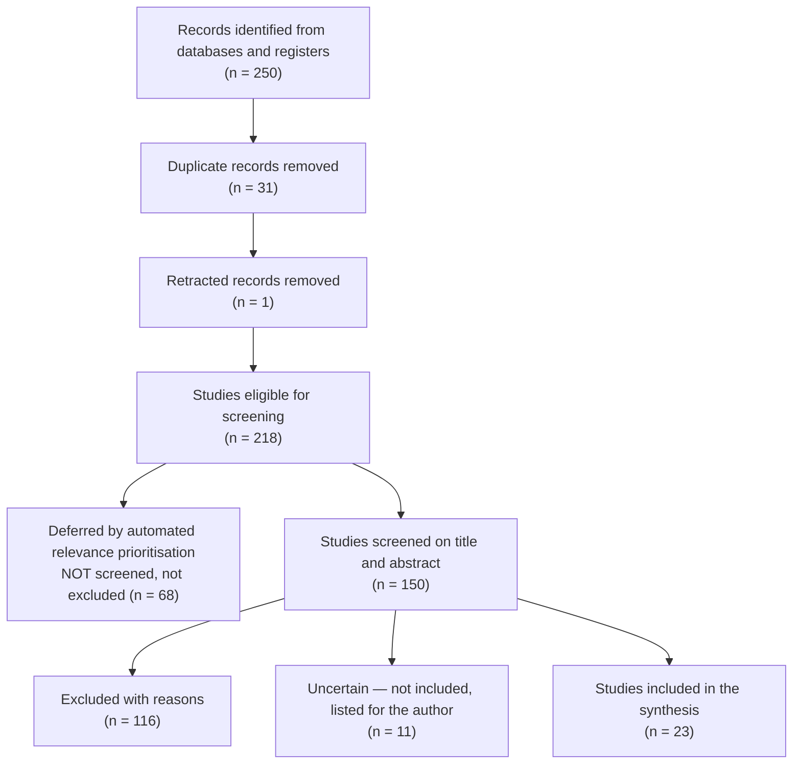

# PRISMA 2020 Flow (P4)

> Every number below is a count of records on disk, not a recollection. Boxes appear
> only for steps that actually ran: eligibility here was decided on **title and
> abstract**, and studies the prefilter deferred are counted as **not screened** —
> never as excluded, because nobody read them. No LLM, no network.

## Flow

## Counts

| Stage | n |
|---|---|
| identified | 250 |
| identified databases registers | 250 |
| identified other methods | 0 |
| after deduplication | 219 |
| duplicates removed | 31 |
| retracted removed | 1 |
| eligible for screening | 218 |
| screened title abstract | 150 |
| deferred not screened | 68 |
| verdicts recorded | 150 |
| excluded title abstract | 116 |
| maybe not included | 11 |
| included | 23 |

## Retracted, removed before screening
Never eligible, and never folded into "duplicates" or the exclusion reasons.
- `doi:10.1371/journal.pone.0321032`

## Exclusion reasons (title/abstract stage)

| Reason | n |
|---|---|
| Other-drug question (SGLT2i/GLP-1 RA/DPP-4i/tirzepatide/insulin/other); metformin only background or absent; no metformin-specific outcome (L-013) | 51 |
| Outcome/indication outside the pre-registered clinical outcomes (cancer, dementia/cognition, COVID, genetics, mechanism, MASLD, musculoskeletal) | 21 |
| Population not adult type 2 diabetes (prediabetes, PCOS, GDM, children, obesity-only, other disease) | 18 |
| Narrative review/editorial without systematic method | 8 |
| Protocol, design or baseline-characteristics report without results | 3 |
| Letter/comment, no primary data | 2 |
| No stable identifier verified (Consensus-only record; PMID/DOI not confirmed in PubMed) - not citable (L-009) | 2 |
| Case report (excluded by protocol except as signal context) | 1 |
| Exposure not metformin-specific (micronutrient burden among all patients with T2D) | 1 |
| Fixed-dose combination with statin; lipid/glycaemic surrogate endpoints; metformin effect not isolated | 1 |
| Intervention is early insulin add-on; no metformin-vs-no-metformin contrast | 1 |
| Outside 2015-2026 window / metformin comparator-only legacy trial (RECORD, start 2001; rosiglitazone question) | 1 |
| Pharmacokinetic/pharmacogenomic/biomarker-only | 1 |
| Population defined by pre-existing CVD irrespective of diabetes status; RCT and cohort data pooled | 1 |
| Prediabetes population (VA-IMPACT NCT02915198, ongoing, primary completion 2029-09); retained only as CVOT-gap context in the store | 1 |
| Registry entry of the Lim 2025 RCT (verdict recorded on the publication record) | 1 |
| Surrogate heart-failure markers only; mixed diabetic/non-diabetic populations | 1 |
| Systematic review limited to newer agents; metformin not evaluated | 1 |

## Consistency check (0)
- the stages add up

## What this does NOT claim
- Eligibility was judged on **title and abstract** — no full-text eligibility assessment was performed, so no such box is drawn.
- Deferred studies were subject to automated relevance prioritisation (deferred studies were NOT read).
- Screening was AI-assisted against protocol criteria, with a human at the gates. Do NOT write "two reviewers independently screened" unless that literally happened.
